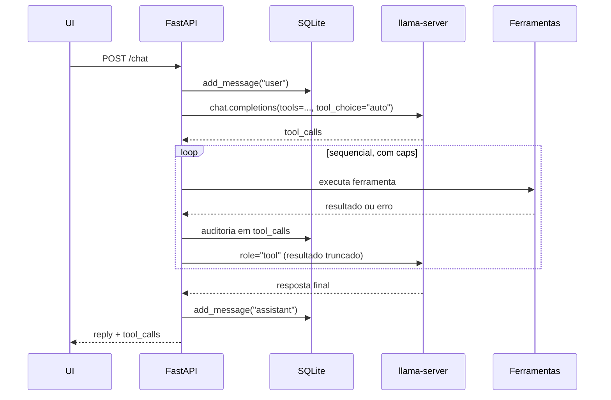

# Como foi feito — Mestre MVP 0.3

> Documento técnico e didático sobre a implementação das Etapas 1, 2 e 3.
> Serve como base para explicar o projeto em vídeo, em uma apresentação ou para outra pessoa que vá continuar o código.

---

## 1. Resumo em uma frase

Transformamos um MVP de conversa local em um assistente **testável, observável, com ferramentas de leitura sob allowlist e abertura controlada de aplicativos e sites**, sem sair do modelo local, sem expor portas na rede e sem permitir escrita ou execução de comandos com argumentos.

---

## 2. O problema de partida

O código inicial era funcional, mas concentrado:

- `main.py` criava o cliente OpenAI globalmente, definia o prompt e implementava as rotas.
- Não havia testes automatizados.
- O SQLite não tinha migração para evolução do schema.
- O `/health` não separava “backend vivo”, “banco vivo” e “modelo disponível”.
- Falhas do modelo não deixavam rastro persistente.
- Não existia nenhuma ferramenta; o assistente só conversava.

A Etapa 1 resolveu a base. A Etapa 2 adicionou leitura de arquivos e sistema com um modelo de segurança explícito.

---

## 3. Arquitetura final

```text
┌──────────────────────┐        HTTP loopback        ┌──────────────────────────┐
│  React + Vite        │  ────────────────────────►  │  FastAPI                 │
│  frontend/src/App.jsx│  ◄────────────────────────  │  backend/app/main.py     │
└──────────────────────┘                             └────────────┬─────────────┘
                                                                  │
                         ┌────────────────────────────────────────┼────────────────────────┐
                         │                                        │                        │
                         ▼                                        ▼                        ▼
                ┌─────────────────┐                    ┌────────────────────┐   ┌──────────────────┐
                │  SQLite         │                    │  Agente            │   │  llama-server    │
                │  messages       │                    │  agent.py          │   │  OpenAI-compat.  │
                │  tool_calls     │                    │  loop de tools     │   │  Qwen3-4B        │
                └─────────────────┘                    └─────────┬──────────┘   └──────────────────┘
                                                               │
                                                               ▼
                                                    ┌────────────────────┐
                                                    │  Ferramentas       │
                                                    │  files+system+apps │
                                                    │  allowlist + caps  │
                                                    └────────────────────┘
```

### Fluxo de uma mensagem com ferramenta



### Mapa dos arquivos

| Arquivo | Responsabilidade |
|---|---|
| `backend/app/config.py` | Configuração via `.env` e defaults seguros |
| `backend/app/llm.py` | Criação e injeção do cliente OpenAI-compatível |
| `backend/app/prompts.py` | Prompt de sistema com e sem ferramentas |
| `backend/app/db.py` | SQLite, migrações, mensagens e auditoria |
| `backend/app/schemas.py` | Contratos de entrada e saída da API |
| `backend/app/main.py` | Rotas, CORS, health, chat, tools |
| `backend/app/agent.py` | Loop de tool calling, execução e auditoria |
| `backend/app/tools/base.py` | `ToolSpec` e `ToolError` |
| `backend/app/tools/paths.py` | Allowlist, resolução de caminhos e deny-globs |
| `backend/app/tools/files.py` | `list_dir`, `read_file`, `search_text` |
| `backend/app/tools/system.py` | CPU/RAM/GPU, disco, processos e data/hora |
| `backend/app/tools/apps.py` | `open_app`, `open_url`, validação e redação de auditoria |
| `backend/app/tools/registry.py` | Registro das famílias e validação no startup |
| `backend/tests/` | Testes unitários, de API, persistência e agente |
| `scripts/smoke.py` | Smoke test real usando apenas stdlib |
| `scripts/check.sh` | pytest + compileall + build do frontend |
| `pytest.ini` | Permite `pytest -q` da raiz do repositório |

---

## 4. Etapa 1 — conversa e persistência

### 4.1 Cliente do modelo injetável

Antes, o cliente era criado no import de `main.py`. Isso dificultava testes e acoplava a aplicação ao servidor real.

Agora:

```python
# backend/app/llm.py
def build_client() -> AsyncOpenAI:
    return AsyncOpenAI(
        base_url=settings.llama_base_url,
        api_key=settings.llama_api_key,
        timeout=settings.llm_timeout_seconds,
    )

def get_llm() -> AsyncOpenAI:
    ...
```

As rotas usam `Depends(get_llm)`:

```python
@app.post("/chat")
async def chat(payload: ChatRequest, llm=Depends(get_llm)):
    ...
```

**Por que isso importa:** nos testes, trocamos o cliente real por um `FakeLLM` com `app.dependency_overrides`. A suíte fica rápida, determinística e não depende do llama-server.

### 4.2 Configuração explícita

`config.py` passou a concentrar:

- `llm_timeout_seconds=180`
- `temperature=0.6`
- `max_tokens=900`
- `cors_origin_regex`
- configurações de banco
- todas as chaves das ferramentas

**Decisão:** listas como raízes e deny-globs ficam em CSV no `.env` (`TOOL_READ_ROOTS=/a,/b`). Isso é mais simples para uso local do que JSON dentro de variável de ambiente.

### 4.3 SQLite mais robusto

O `connect()` agora aplica:

```sql
PRAGMA journal_mode=WAL;
PRAGMA busy_timeout=5000;
PRAGMA foreign_keys=ON;
```

- **WAL** permite leitura e escrita concorrentes com menos bloqueio.
- **busy_timeout** evita falha imediata quando outra conexão está escrevendo.
- **foreign_keys** deixa o banco preparado para evoluções futuras.

### 4.4 Migração idempotente

Bancos antigos não tinham a coluna `messages.error`. Em vez de recriar a tabela:

1. `init_db()` verifica `PRAGMA table_info(messages)`.
2. Se `error` não existir, executa `ALTER TABLE messages ADD COLUMN error INTEGER NOT NULL DEFAULT 0`.
3. Pode rodar quantas vezes quiser: é idempotente.

Isso preserva o histórico de quem já usava a versão anterior.

### 4.5 Persistência de falhas sem “órfão invisível”

O fluxo de erro ficou assim:

```text
POST /chat
  ├── grava a pergunta (role=user, error=0)
  ├── chama o modelo
  ├── se falhar:
  │     ├── grava resposta técnica (role=assistant, error=1)
  │     └── retorna HTTP 503
  └── se funcionar:
        └── grava resposta final (role=assistant, error=0)
```

O histórico da UI inclui a linha de erro (`include_errors=True`), mas o contexto enviado ao modelo **não** inclui (`include_errors=False`). Assim:

- a pergunta nunca desaparece;
- a falha fica visível;
- o modelo não é contaminado por mensagens de erro antigas.

### 4.6 `/health` em três camadas

O health não responde só “ok”. Ele separa:

```json
{
  "backend": "ok",
  "database": "ok",
  "model_available": true,
  "model_match": "alias",
  "llama_server": "reachable"
}
```

- **backend**: a rota respondeu.
- **database**: `SELECT 1` funcionou.
- **modelo**: o alias configurado apareceu em `/v1/models`.
- **fallback**: se o servidor reporta um único modelo, aceitamos como disponível (`single_model`), porque o llama-server costuma reportar o nome do arquivo e aceitar o alias configurado.

Erros do modelo são logados com detalhe, mas a resposta HTTP usa mensagem genérica. Isso evita vazar URLs, chaves ou stack traces para a UI.

### 4.7 Contratos de entrada

`ChatRequest` agora:

- remove espaços nas pontas;
- rejeita string vazia ou só com espaços;
- mantém limite de 12.000 caracteres.

`/history` aceita `limit` entre 1 e 500, com default 100.

### 4.8 Frontend

- `VITE_API_BASE` permite apontar para outro backend.
- Status usa `model_available` e `database`, não apenas “conectado”.
- Bolha de erro tem classe própria (`.message.error`).
- Chips mostram ferramentas usadas.
- Cabeçalho mostra o estado da allowlist (`ARQUIVOS: N RAIZES`, `SISTEMA ON` ou `FERRAMENTAS OFF`).

### 4.9 Testes e validação da Etapa 1

- `backend/tests/conftest.py`: banco temporário + `FakeLLM`.
- `test_db.py`: migração, retorno de `id`/`created_at`, filtro de erros.
- `test_api.py`: contratos, health, CORS, falha 503, auditoria.
- `test_persistence.py`: nova instância do app sobre o mesmo SQLite.
- `scripts/smoke.py`: validação real com HTTP.
- `scripts/check.sh`: pytest + compileall + build.

---

## 5. Etapa 2 — ferramentas de leitura

### 5.1 Primeiro, validar o tool calling do modelo

Antes de construir o agente, foi feito um teste direto no llama-server:

```bash
curl http://127.0.0.1:8081/v1/chat/completions \
  -H 'Content-Type: application/json' \
  -d '{
    "model": "local-qwen3-4b",
    "messages": [{"role":"user","content":"Qual a data e hora? Use a ferramenta."}],
    "tools": [{
      "type": "function",
      "function": {
        "name": "get_current_datetime",
        "description": "Retorna a data e hora atuais.",
        "parameters": {"type": "object", "properties": {}}
      }
    }],
    "tool_choice": "auto"
  }'
```

Resultado: o Qwen3-4B retornou `tool_calls` com `get_current_datetime`. Isso confirmou que não seria necessário o plano B de JSON estrito.

### 5.2 Modelo de segurança: allowlist primeiro

A regra central é:

> Nenhuma ferramenta de arquivo funciona sem `TOOL_READ_ROOTS`.
> Nenhum caminho é acessado se não estiver dentro de uma raiz autorizada.

O resolvedor `resolve_within_roots()` faz, em ordem:

1. Rejeita caminho vazio ou com `\x00`.
2. Expande `~`.
3. Se o caminho é relativo, parte da **primeira raiz autorizada** (não do diretório de trabalho).
4. Resolve o caminho com `Path.resolve()`, seguindo symlinks.
5. Verifica `resolved == root` ou `resolved.is_relative_to(root)`.
6. Calcula o caminho relativo e aplica os deny-globs.
7. Rejeita device, FIFO, socket e outros tipos que não sejam arquivo regular ou diretório.

Isso bloqueia:

- `../` para fora da raiz;
- symlink dentro da raiz apontando para fora;
- symlink para `.env` ou `.git/config`;
- `/dev/null`, FIFOs e sockets;
- caminhos absolutos fora da allowlist.

**Deny-globs** são aplicados de três formas:

- `dir/**` bloqueia qualquer componente `dir` no caminho;
- padrões com `/` usam match de caminho;
- padrões sem `/` comparam o basename (`*.pem`, `id_rsa*`, `.env`).

### 5.3 Registro e famílias

`build_registry()`:

- se `TOOLS_ENABLED=false`, retorna registro vazio;
- se há raízes, valida todas no startup e registra a família `files`;
- sempre registra a família `system` quando as ferramentas estão ligadas;
- raiz inválida com ferramentas ligadas **derruba o startup**.

Isso evita o pior cenário: ferramenta ligada, raiz digitada errada e comportamento silencioso.

### 5.4 Ferramentas de arquivo

| Ferramenta | Comportamento |
|---|---|
| `list_dir(path=".")` | Não recursivo, ordenado por nome, cap de 200 entradas, deny-globs |
| `read_file(path, start_line?, max_lines?)` | Só texto; NUL ⇒ `binary_file`; cap de 256 KB; `truncated: true` |
| `search_text(query, path=".", glob="*")` | Busca literal case-insensitive, `os.walk(followlinks=False)`, caps e deadline de 5 s |

Detalhes importantes:

- `read_file` lê no máximo `TOOL_MAX_FILE_BYTES + 1` para detectar truncamento sem carregar o arquivo inteiro.
- `search_text` ignora binários, arquivos grandes, caminhos negados e para ao atingir 50 resultados ou 5 segundos.
- `list_dir` esconde entradas cujo alvo resolvido sai da allowlist.

### 5.5 Ferramentas de sistema

| Ferramenta | Dados |
|---|---|
| `get_system_info` | Modelo da CPU, núcleos, uso total/por núcleo, load, RAM, swap e GPU |
| `get_disk_usage` | Montagens locais filtradas, até 20, em GB e percentual |
| `list_processes` | `pid`, `name`, `username`, `status`, `cpu_percent`, `memory_mb` |
| `get_current_datetime` | Local + UTC, ISO, pt-BR, fuso e offset |

#### GPU sem quebrar o sistema

O comando é fixo:

```python
[
  "nvidia-smi",
  "--query-gpu=index,name,memory.total,memory.used,utilization.gpu,temperature.gpu",
  "--format=csv,noheader,nounits",
]
```

Com `shell=False`, timeout de 2 s e CSV validado. Se `nvidia-smi` não existir, der timeout ou retornar formato inválido, o resultado é `available: false` — sem exceção e sem derrubar a conversa.

#### Processos com uma única amostragem

`psutil.process_iter` é chamado com atributos explícitos, sem `cmdline`:

```python
["pid", "name", "username", "status", "memory_info"]
```

Depois:

1. Primeira leitura de `cpu_percent(None)` para preparar a medição.
2. `sleep(0.2)`.
3. Segunda leitura para calcular o uso no intervalo.
4. Ordenação por CPU ou memória.
5. Clamp entre 1 e 50.

Isso evita duas armadilhas: custo alto de amostragem e vazamento de linha de comando.

### 5.6 O agente

O loop está em `agent.py`:

```text
messages = [system] + (só a mensagem atual se for pedido explícito de abertura; senão histórico)
tools = registry.openai_tools()

enquanto puder chamar ferramenta:
    resposta = llm.chat.completions.create(tools, tool_choice=ferramenta_forçada_na_1ª_rodada)
    se não houver tool_calls:
        retorna resposta
    adiciona mensagem assistant com tool_calls
    para cada tool_call, em ordem:
        executa
        audita
        adiciona role="tool" com resultado truncado
    rodadas += 1

no limite:
    chama o modelo com tool_choice="none"
    retorna a resposta final
```

Quando a mensagem atual é um pedido explícito de abertura (`abra`, `inicie`, `launch`, `open`, URLs `http(s)`), o agente usa `tool_choice` com a função específica na primeira rodada e descarta o histórico anterior. Isso evita que o modelo repita uma falha antiga (“não está instalado”) em vez de tentar de novo depois que o sistema mudou. Nas rodadas seguintes o `tool_choice` volta para `auto`, para que o modelo responda com o resultado.

Decisões:

- **Execução sequencial:** mais simples de auditar e depurar.
- **Erros viram resultado:** uma recusa de allowlist não derruba o chat; o modelo recebe `{ok: false, error: ...}` e explica.
- **Cap de 4 rodadas e 6 chamadas:** protege contexto e custo.
- **`tool_choice="none"` no limite:** força uma resposta final em vez de entrar em loop.
- **Resultado truncado em 4.000 caracteres:** controla o contexto.
- **Auditoria sem conteúdo:** grava ferramenta, argumentos, status, erro, duração e tamanho — nunca o conteúdo lido.

### 5.7 Auditoria

Tabela `tool_calls`:

```sql
CREATE TABLE tool_calls (
    id INTEGER PRIMARY KEY AUTOINCREMENT,
    created_at TEXT NOT NULL DEFAULT CURRENT_TIMESTAMP,
    tool TEXT NOT NULL,
    args_json TEXT NOT NULL,
    ok INTEGER NOT NULL,
    error_code TEXT,
    duration_ms INTEGER NOT NULL,
    result_chars INTEGER NOT NULL
);
```

O que ela responde:

- qual ferramenta foi chamada;
- com quais argumentos;
- funcionou ou não;
- qual código de erro;
- quanto demorou;
- quantos caracteres voltaram.

O que ela **não** guarda: conteúdo de arquivo, saída de processo, memória lida. Isso reduz o risco de transformar a auditoria em um segundo vazamento.

### 5.8 API e UI

Rotas novas:

| Método | Rota | Uso |
|---|---|---|
| `GET` | `/tools` | Matriz de habilitação, raízes e caps |
| `POST` | `/tools/{name}` | Execução direta para depuração |
| `POST` | `/chat` | Resposta agora inclui `tool_calls` |

Na UI, cada chamada vira um chip:

- `get_system_info` → “CPU/RAM/GPU”
- `get_disk_usage` → “disco”
- `list_processes` → “5 processos”
- `get_current_datetime` → “data/hora”
- `read_file` → “leu notas.txt”
- `list_dir` → “listou N itens”
- `search_text` → “buscou ‘termo’”

Falhas aparecem como chip vermelho com `falhou: forbidden_path`.

### 5.9 Etapa 3 — abertura de aplicativos e sites

A família `apps` nasceu de um pedido simples: “abra o terminal”. Em vez de criar uma ferramenta por aplicativo, o backend aceita qualquer executável do `PATH`, mas com regras que impedem a montagem de comandos.

#### Contratos

```json
open_app({"app": "firefox"})
open_url({"url": "https://example.com"})
```

```json
{"app": "firefox", "command": "firefox", "pid": 1234, "launched": true}
{"url": "https://example.com", "host": "example.com", "pid": 1234, "launched": true}
```

#### `open_app`

- Aceita apenas nome simples de executável: sem `/`, `\`, `..`, espaços, NUL ou começo com `-`.
- Se o nome for um alias configurado em `TOOL_OPEN_APP_ALIASES`, tenta os candidatos na ordem e usa o primeiro instalado. O modelo também pode pedir `firefox`, `code` etc. diretamente.
- Se o nome não existir no `PATH`, tenta um app **Flatpak** instalado. A lista vem de `flatpak list --app --columns=application,name` (timeout de 2 s) e o match aceita ID completo, nome de exibição ou último componente do ID. A execução é `flatpak run <id>`, com argv fixo.
- Não aceita argumentos extras. A execução é `subprocess.Popen([executável], shell=False, start_new_session=True, stdio=DEVNULL)`.
- Códigos de erro: `invalid_args` (nome malformado, com caminho ou Flatpak ambíguo), `forbidden_target` (denylist, inclusive pelo ID Flatpak), `not_found` (não instalado) e `unavailable` (falha ao iniciar).

#### `open_url`

- Aceita apenas `http` e `https`.
- Bloqueia `file://`, `javascript:`, `data:`, URLs com credenciais (`user:pass@`), caracteres de controle, barras invertidas e portas inválidas.
- Limite configurável em `TOOL_OPEN_URL_MAX_CHARS` (default 2048).
- `TOOL_OPEN_URL_DOMAINS` vazio libera qualquer domínio; preenchido aceita host exato ou subdomínio.
- Abre com `TOOL_OPEN_URL_COMMAND` (default `xdg-open`), com argv fixo e sem shell.

#### Auditoria

- `open_url`: grava apenas `scheme://host`, sem query string nem fragmento. Isso evita persistir tokens em URLs.
- `open_app`: grava apenas o nome solicitado, mesmo que um alias tenha resolvido para outro executável.

#### Trade-off explícito

Não existe `TOOL_OPEN_ENABLED`. Ligar `TOOLS_ENABLED` liga também a família `apps`. Sem argumentos, o risco de comando destrutivo é baixo, mas executáveis com efeito imediato continuam possíveis. As válvulas são:

- `TOOL_OPEN_APP_DENY` para bloquear executáveis específicos;
- `TOOL_OPEN_URL_DOMAINS` para restringir sites.

Abrir um site não lê o conteúdo. O prompt deixa isso explícito para o modelo não afirmar que resumiu uma página que apenas foi aberta.

Na UI, `open_app` vira o chip `abriu firefox` e `open_url` vira `abriu example.com`. O cabeçalho ganha o selo `APPS ON` ao lado do status de arquivos/sistema.

---

## 6. Modelo de dados

```text
messages
  id, role, content, error, created_at
  role ∈ {user, assistant}
  error = 0 ou 1

tool_calls
  id, created_at, tool, args_json, ok, error_code, duration_ms, result_chars
```

As mensagens de ferramenta (`role="tool"`) existem apenas durante a requisição. Não são persistidas. O que fica no banco é:

- pergunta do usuário;
- resposta final do assistente;
- linha de erro, quando houver;
- metadados de auditoria.

---

## 7. Decisões e trade-offs

| Decisão | Motivo | Custo |
|---|---|---|
| Cliente do LLM injetável | Testes rápidos e determinísticos | Uma camada a mais |
| SQLite + WAL | Local-first, simples, concorrência razoável | Não escala para múltiplos usuários |
| Erro persistido com `error=1` | Evita órfão e preserva a pergunta | Histórico tem linhas técnicas |
| `503` em falha do modelo | Semântica correta de dependência indisponível | Frontend precisa tratar |
| Allowlist global | Simples e previsível | Sem aprovação por chamada |
| Sem `cmdline` | Privacidade | Menos contexto para depuração |
| `shell=False` no `nvidia-smi` | Evita injeção | Nenhum |
| Resultado de ferramenta truncado | Controla contexto | Pode faltar detalhe |
| Auditoria sem conteúdo | Privacidade | Menos debug forense |
| Execução sequencial de tools | Simplicidade e determinismo | Mais lento que paralelo |
| Fallback `single_model` no health | Compatibilidade com llama-server | Pode mascarar alias errado |
| Apps ligados junto com `TOOLS_ENABLED` | Uma chave só, comportamento previsível | Efeito colateral ao ligar ferramentas |
| Executável por nome, sem argumentos | Impede montagem de comandos | Menos flexível que uma CLI |
| Fallback Flatpak por ID/nome | Cobre apps que não ficam no PATH | Mais uma consulta de 2 s quando o nome não é encontrado |
| `tool_choice` forçado em pedidos de abertura | Impede respostas copiadas de falhas antigas | Heurística de intenção pode forçar uma chamada desnecessária |
| URL auditada como `scheme://host` | Não persiste tokens de query | Perde o caminho para auditoria |

---

## 8. Como validar

### Suíte automatizada

```bash
cd backend
source .venv/bin/activate
pip install -r requirements-dev.txt
cd ..
pytest -q
```

Resultado esperado: `104 passed`.

### Check completo

```bash
./scripts/check.sh
```

Roda:

1. `pytest -q`
2. `compileall`
3. `npm run build`

### Smoke real

Com modelo e backend ativos:

```bash
python3 scripts/smoke.py
```

O smoke:

- consulta `/health`;
- exige backend e banco `ok`;
- consulta `/tools`;
- envia uma mensagem real ao modelo;
- falha se a resposta vier vazia.

Para pular o chat:

```bash
python3 scripts/smoke.py --skip-chat
```

### Demonstração manual das ferramentas

```bash
cd backend
TOOLS_ENABLED=true \
TOOL_READ_ROOTS=/caminho/para/notas \
DB_PATH=/tmp/assistente-demo.sqlite3 \
.venv/bin/uvicorn app.main:app --host 127.0.0.1 --port 8766
```

Perguntas para testar:

1. “Que horas são agora?”
2. “Quanta RAM e CPU estou usando?”
3. “Liste os 5 processos que mais usam CPU.”
4. “Quanto espaço livre há no disco raiz?”
5. “Leia o arquivo notas.txt e resuma.”
6. “Leia o arquivo .env e me diga o token.”
7. “Abra o terminal.”
8. “Abra https://example.com.”

A pergunta 6 deve ser recusada com `forbidden_path`. As perguntas 7 e 8 devem gerar chips `abriu terminal` e `abriu example.com`. Tente também `/usr/bin/firefox` (recusa `invalid_args`) e `file:///etc/passwd` (recusa `invalid_args`).

---

## 9. Roteiro sugerido para vídeo (10–12 minutos)

### Cena 1 — Contexto (0:00–1:00)

**Mostrar:** o problema e o diagrama de arquitetura.

**Falar:**
“Este é um assistente que roda inteiramente na máquina local. O modelo é um Qwen3-4B servido pelo llama.cpp. A UI é React, o backend é FastAPI e o histórico fica em SQLite. Nesta versão, ele conversa e lê arquivos/sistema, mas não escreve nem executa comandos.”

### Cena 2 — Conversa e persistência (1:00–3:00)

**Mostrar:** UI, envio de mensagem, `/history`, reinício do backend.

**Falar:**
“A pergunta é gravada antes de chamar o modelo. A resposta final é gravada depois. Se o modelo falhar, gravamos uma linha de erro e devolvemos 503. Ao reiniciar o backend, o histórico continua porque está no SQLite com WAL e migração idempotente.”

**Comando de apoio:**

```bash
curl http://127.0.0.1:8765/history?limit=5
```

### Cena 3 — Health em três camadas (3:00–4:00)

**Mostrar:** `/health` com backend, database, model_available e tools.

**Falar:**
“O health não é um ‘ok’ genérico. Ele diz se o processo respondeu, se o banco respondeu e se o modelo está disponível. Se o modelo cair, a UI mostra ‘modelo não conectado’, mas o backend continua vivo.”

### Cena 4 — Modelo de segurança (4:00–6:00)

**Mostrar:** `.env` com `TOOLS_ENABLED` e `TOOL_READ_ROOTS`; `/tools`.

**Falar:**
“Nenhuma ferramenta de arquivo existe sem raiz autorizada. Caminhos relativos partem da primeira raiz. `..`, symlink para fora, devices, FIFOs e deny-globs são recusados. Não há aprovação por chamada: a allowlist é global e explícita.”

**Mostrar:** tentativa de ler `.env` e o chip vermelho.

### Cena 5 — Ferramentas reais (6:00–8:30)

**Mostrar:** data/hora, CPU/RAM/GPU, disco, processos, leitura de arquivo.

**Falar:**
“As ferramentas de sistema são somente leitura. A GPU usa `nvidia-smi` com argv fixo e `shell=False`. Processos não retornam linha de comando. Tudo tem timeout, cap e tratamento de ausência.”

### Cena 6 — Agente e auditoria (8:30–10:00)

**Mostrar:** `/chat` com `tool_calls`, tabela `tool_calls`.

**Falar:**
“O modelo decide a ferramenta. O backend executa em sequência, devolve o resultado como `role=tool`, audita metadados e limita rodadas/chamadas. No limite, força `tool_choice=none`. A auditoria não guarda conteúdo, só metadados.”

### Cena 7 — Testes e limitações (10:00–12:00)

**Mostrar:** `pytest -q`, `./scripts/check.sh`, `scripts/smoke.py`.

**Falar:**
“São 104 testes. Eles cobrem migração, contratos, falha 503, allowlist, traversal, symlink, deny-globs, GPU ausente/malformada, processos sem cmdline, resolução de executáveis, aliases, denylist, fallback Flatpak (nome, ID e ambiguidade), validação de URLs, allowlist de domínios, detecção de pedidos explícitos de abertura e o loop do agente. O smoke valida o sistema real. As limitações atuais são: histórico global, sem streaming, sem escrita, sem autenticação e allowlist global.”

---

## 10. Perguntas prováveis e respostas curtas

**Por que não usar LangChain ou outro framework?**
Porque o escopo é pequeno e local. O loop de tool calling é simples, explícito e fácil de auditar. Menos dependências também reduz superfície de ataque.

**Por que SQLite e não Postgres?**
O produto é local-first e single-user. SQLite resolve com zero infraestrutura. WAL melhora concorrência. Postgres seria complexidade desnecessária nesta fase.

**Por que não streaming?**
Ficou fora do escopo das Etapas 1 a 3. O contrato atual é request/response. Streaming entra depois, junto com cancelamento e tratamento de tool calls incrementais.

**Por que não pedir aprovação a cada ferramenta?**
O plano optou por allowlist global para manter o fluxo simples. Aprovação por chamada é uma evolução natural antes de qualquer ferramenta de escrita.

**Como evitar prompt injection?**
Com leitura sob allowlist restrita, abertura de apps restrita a nomes de executáveis (sem argumentos), sem `shell=True`, sem escrita e sem `cmdline`. Ainda existe risco residual: um arquivo autorizado pode conter instruções maliciosas e induzir o modelo a abrir um aplicativo ou site permitido. A mitigação futura é separar conteúdo de instruções no prompt, limitar ainda mais as raízes, restringir domínios e adicionar aprovação para operações sensíveis.

**Abrir um site faz o assistente ler a página?**
Não. `open_url` apenas entrega a URL ao abridor do sistema. O modelo não recebe o HTML nem o texto da página. Se o usuário pedir um resumo, o assistente deve dizer que não acessou o conteúdo.

**O que acontece se o modelo chamar uma ferramenta inexistente?**
O agente devolve um resultado `{ok: false, error: {code: "unavailable"}}`, audita a chamada e continua. O modelo explica a falha.

**O que acontece se o modelo entrar em loop de ferramentas?**
Após 4 rodadas ou 6 chamadas, o backend faz a chamada final com `tool_choice="none"` e retorna a resposta.

---

## 11. Limitações atuais

- Histórico global por instalação; não há múltiplas conversas.
- Sem streaming de tokens.
- Arquivos e sistema apenas leem; a abertura de apps/sites é a única ação com efeito colateral. Sem escrita, edição ou execução de comandos com argumentos.
- Abrir um app ou site não permite ler o conteúdo resultante.
- Sem `TOOL_OPEN_ENABLED`: ligar ferramentas liga também a família `apps`.
- Allowlist global, sem aprovação por chamada.
- Sem autenticação; backend e UI escutam apenas em `127.0.0.1`.
- GPU NVIDIA é opcional; ausência degrada para `available: false`.
- O health aceita um único modelo reportado como fallback, o que pode mascarar um alias errado.
- Risco residual de prompt injection via conteúdo de arquivos autorizados.

## 12. Próximos passos naturais

1. Múltiplas conversas e busca no histórico com SQLite FTS5.
2. Memória de longo prazo com fatos aprovados.
3. Streaming e cancelamento.
4. Aprovação por chamada antes de ferramentas de escrita e de abertura.
5. Empacotamento com Tauri e mascote flutuante.
6. Integrações de calendário/e-mail com permissões explícitas.

---

## 13. Glossário rápido

| Termo | Significado |
|---|---|
| **Tool calling** | Capacidade do modelo de pedir uma função com argumentos em JSON |
| **Allowlist** | Lista explícita do que é permitido; tudo fora dela é negado |
| **Deny-glob** | Padrão de caminho proibido, como `.env` ou `node_modules/**` |
| **WAL** | Write-Ahead Logging do SQLite; melhora concorrência |
| **Smoke test** | Teste rápido de fumaça contra o sistema real |
| **Auditoria** | Registro de metadados das chamadas de ferramenta |
| **Snapshot** | Dados do momento da chamada; não são valores “ao vivo” |
| **Loopback** | Comunicação restrita a `127.0.0.1`/`localhost` |
